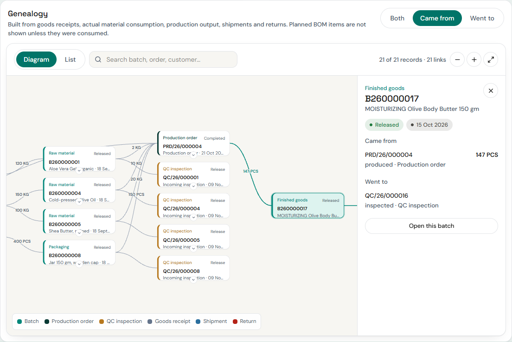
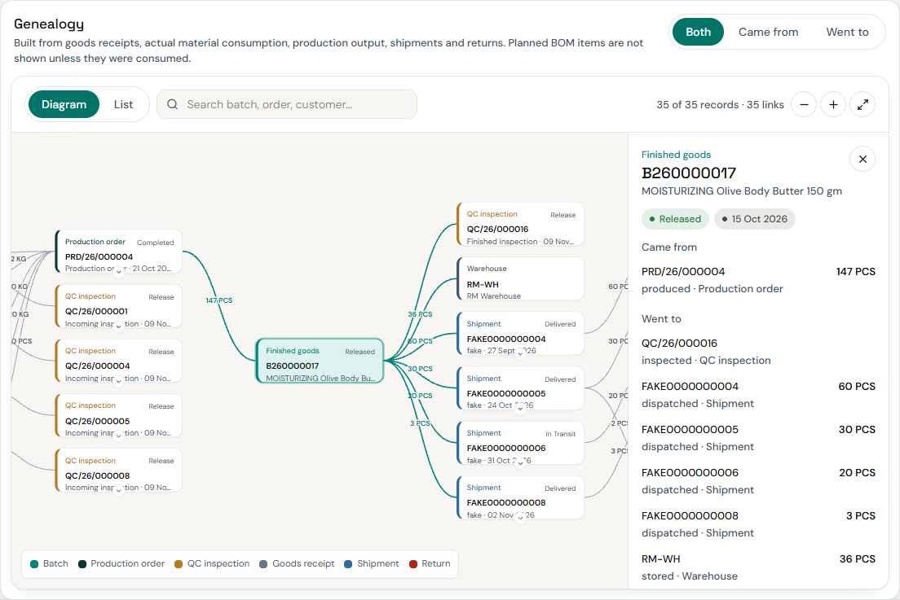

# Batch genealogy

How the diagram and the list view on Batch 360 are produced, and what they do and do not claim.

## Rule 1: only recorded consumption is genealogy

A BOM or formulation says what a product *should* contain. It tells you nothing about which supplier lot was in the tank. The graph therefore never reads `bom_lines` or `formulation_ingredients`. A lot appears in a finished batch's ancestry **only** if a `production_consumptions` row ties that lot to the order that made the batch. Test: `test_bom_alone_does_not_create_genealogy` releases extra stock of the same material that is never consumed and asserts it is absent.

The recipe (formulation version, BOM version) is shown **on the production order node** as context ("this order used FORM-X v2 / BOM v1"), with an edge labelled `recipe`; it carries no quantity.

## Node types

| Type | Record | Link |
|---|---|---|
| `supplier` | supplier | masters (only if allowed) |
| `purchase_order`, `goods_receipt` | PO, receipt | Purchase screens (`?open=`) |
| `opening_stock` | stock loaded at go-live | none |
| `batch` | an inventory batch; `kind` = RM / PM / BULK / FG | its own Batch 360 |
| `production_order`, `formulation`, `bom` | order, version, BOM | Production / R&D screens |
| `qc` | an inspection; status = its decision | Quality screen |
| `warehouse`, `reservation` | where it is stored; stock promised to an order | |
| `shipment`, `sales_order`, `customer`, `return` | outbound and returns | Dispatch screens |

Edges carry a quantity and unit (batch → order = consumed, order → batch = produced, batch → shipment = dispatched, shipment → return = returned, batch → warehouse = stored, batch → reservation = reserved) and the date of the underlying movement where it exists.

## Cases

| Case | How it appears |
|---|---|
| **Multi-source**: one order consumes several lots of one material | several `batch → order` edges, one per lot, each with its own consumed quantity |
| **One lot, many orders** | the lot has several `consumed` edges; forward view shows every order and every batch they made |
| **Bulk then finished** | the walk continues through the bulk output batch to the finished batch (and back the other way), up to the depth limit |
| **Split** | one batch node with several `stored` edges (one per warehouse); the movements tab shows the `TRANSFER_OUT/IN` legs; reconciliation nets them to zero |
| **Partial dispatch** | several shipments off the same batch, each with its own quantity |
| **Return** | a `return` node hanging off the shipment it came from; the batch's reconciliation counts returned units separately |
| **Failed then retested** | the inspection node and the Inspections tab keep every result row; the failed one is flagged, `retested` is true |
| **Rejected / held stock** | status badge on the node; the stock is counted under *blocked*, never *available* |

## Interaction

Pan by dragging, zoom with the wheel or the +/- buttons, **Fit** shows the whole graph (legible only for small genealogies). Backward and forward views start with the focus batch at the right and left edge respectively so the whole lineage is in view. Click a node for its side panel (status, date, quantities in and out, **Open record**); double-click a batch node to open that batch. Search dims nodes that do not match. Each non-focus node has a chevron to collapse its branch. **List** shows the same nodes and edges as a table with quantity in/out per record, for anyone who prefers it or for very large graphs.

## Limits

Depth 6 generations, 300 nodes. If either is reached the page says "limit reached, open a node to continue from it". Opening a batch node recentres the graph on that batch, so any depth is reachable.

## Not supported

* **Merging batches** and **child batches**: no such operation exists in the application (see `PRODUCT_360_ARCHITECTURE.md`). Nothing is fabricated.
* **Apportioning a mixed batch.** The system records which lots an order consumed, not how they mixed in the tank. A finished batch is therefore either in a lot's descendants or not; it is never "37% affected".
