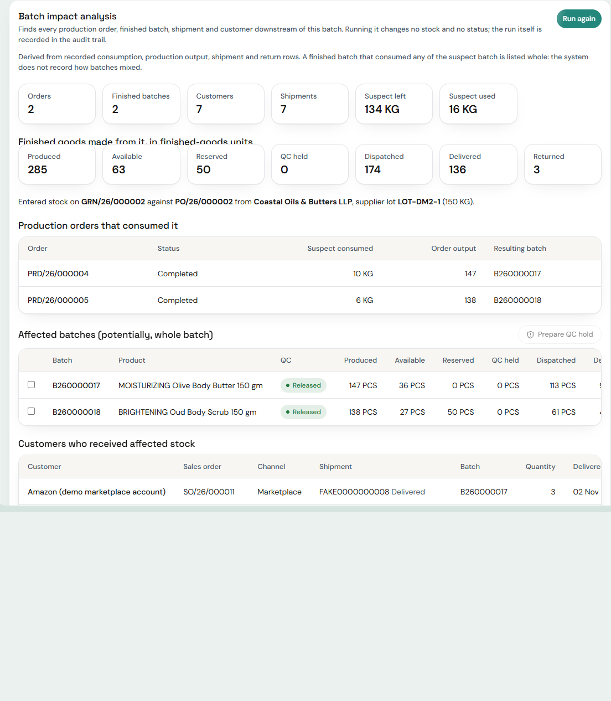

# Batch impact analysis

For the day a supplier says "lot X has a problem" or a test fails: **what did this batch go into, what is left, and who has it?**

Batch 360 → **Impact analysis** tab → *Run impact analysis*. Needs `inventory.batch:read` **and** `inventory.batch:qc_release`.

## What running it does, and does not do

| It does | It does not |
|---|---|
| read recorded consumption, production output, shipment and return rows | change any stock, status, reservation or order |
| write **one audit row** (`action = impact_analysis`, `entity = batch_impact`, who, when, counts) | block stock, start a recall, contact a customer, or notify anyone |
| show who and what is downstream, with quantities by state | decide that anything is "bad" |

Test: `test_permissions_masking_audit_and_read_only` asserts stock balances and the ledger are unchanged after a run and that exactly one audit row is added.

## What it returns

1. **Entry:** the goods receipt, PO, supplier (if you may see suppliers) and supplier lot the batch came in on.
2. **Production orders** that actually consumed it, with the quantity of the suspect batch each consumed.
3. **Affected batches**: every batch those orders produced, continued through bulk → finished. For each: produced, physical, available, reserved, QC-held, dispatched, delivered, returned, and QC status.
4. **Customers**: every sales order, shipment and customer that received a unit from an affected finished batch, with quantity, shipment status and delivery date. Names are "Restricted" if you may not read customers.
5. **Totals for finished goods** (finished-goods units only; bulk batches are intermediates and are not double counted): produced, available, reserved, QC-held, dispatched, delivered, returned.
6. The suspect batch's own remaining stock and how much of it was consumed.

## How to read "affected"

The system records **which lots an order consumed, not how they mixed**. A finished batch that consumed any of the suspect lot is therefore listed **whole**, as *potentially* affected, and its full quantities are reported. It is never apportioned ("a third of this batch"). The page says so under the heading. That is the conservative, honest answer for a recall decision.

## Acting on it

The only consequential action offered is **Prepare QC hold**: tick the affected batches that are RELEASED or in QUARANTINE and confirm. The confirmation dialog lists the batches and states that held stock cannot be issued, reserved or dispatched until Quality releases it, and that **no recall is started and no customer is contacted**. Confirming calls the **existing QC decision endpoint** one batch at a time (`decision = HOLD`, a reason naming the suspect batch), so the normal permission check, state machine (a REJECTED batch cannot be moved), idempotency key and audit apply. Results are toasted per batch; failures are listed, not hidden.

There is no automatic hold, recall or customer communication anywhere. A recall *case* (workflow, customer letters, regulator reporting) is **not built**; see known limitations.

## Worked example in the demo database

`B260000004` (a raw lot) reaches 7 customers through its production orders. Running the analysis shows the orders, the finished batches, how much is still on shelf, what is held, and which customers received what. `docs/DEMO_TRACEABILITY_SCENARIOS.md` has the batch numbers.
