# Entity Relationship Map

Generated by `backend/scripts/gen_schema_docs.py` (Alembic revision **0023**). Each diagram lists the foreign keys that start in that domain; a table drawn without attributes belongs to another domain. Cross-domain links are exactly the places where one module reuses another module's master record (items, suppliers, customers, warehouses, batches, users).

## Platform & infrastructure

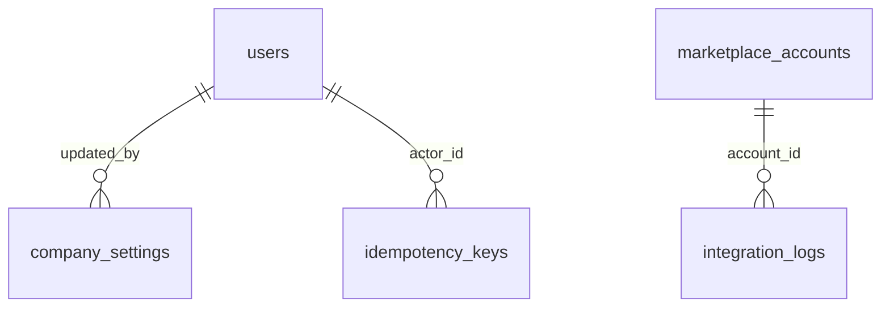

## Identity, access & audit

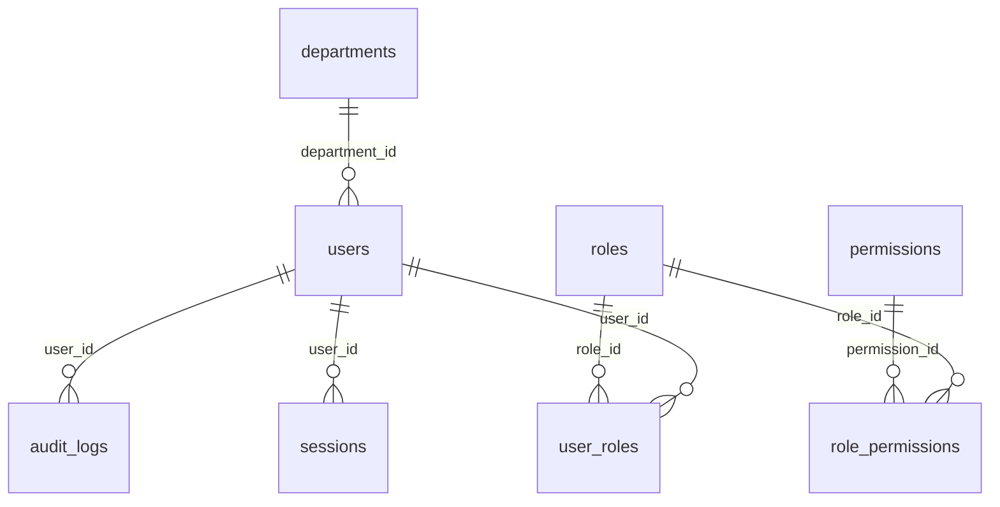

## Master data

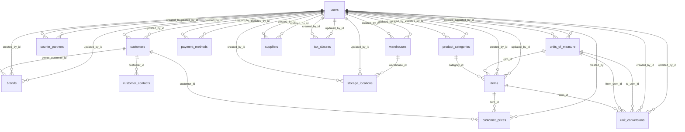

## Inventory

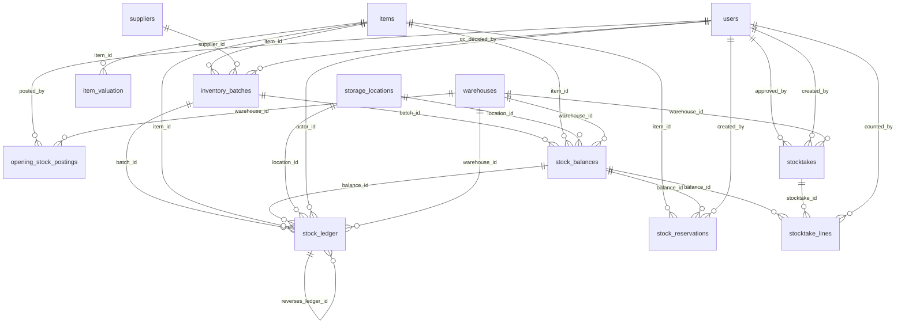

## Procurement

```mermaid
erDiagram
    journal_entries ||--o{ debit_notes : "journal_entry_id"
    supplier_invoices ||--o{ debit_notes : "supplier_invoice_id"
    users ||--o{ debit_notes : "created_by"
    goods_receipts ||--o{ goods_receipt_items : "gr_id"
    inventory_batches ||--o{ goods_receipt_items : "batch_id"
    items ||--o{ goods_receipt_items : "item_id"
    purchase_order_items ||--o{ goods_receipt_items : "po_item_id"
    storage_locations ||--o{ goods_receipt_items : "location_id"
    purchase_orders ||--o{ goods_receipts : "po_id"
    suppliers ||--o{ goods_receipts : "supplier_id"
    users ||--o{ goods_receipts : "posted_by"
    warehouses ||--o{ goods_receipts : "warehouse_id"
    po_amendments ||--o{ po_amendment_lines : "amendment_id"
    purchase_order_items ||--o{ po_amendment_lines : "po_item_id"
    purchase_orders ||--o{ po_amendments : "po_id"
    users ||--o{ po_amendments : "decided_by"
    users ||--o{ po_amendments : "requested_by"
    items ||--o{ purchase_order_items : "item_id"
    purchase_orders ||--o{ purchase_order_items : "po_id"
    purchase_requests ||--o{ purchase_orders : "pr_id"
    suppliers ||--o{ purchase_orders : "supplier_id"
    users ||--o{ purchase_orders : "approved_by"
    users ||--o{ purchase_orders : "created_by"
    items ||--o{ purchase_request_items : "item_id"
    purchase_requests ||--o{ purchase_request_items : "pr_id"
    departments ||--o{ purchase_requests : "department_id"
    users ||--o{ purchase_requests : "requested_by"
    goods_receipt_items ||--o{ purchase_return_lines : "gr_item_id"
    inventory_batches ||--o{ purchase_return_lines : "batch_id"
    items ||--o{ purchase_return_lines : "item_id"
    purchase_returns ||--o{ purchase_return_lines : "return_id"
    goods_receipts ||--o{ purchase_returns : "goods_receipt_id"
    journal_entries ||--o{ purchase_returns : "journal_entry_id"
    purchase_orders ||--o{ purchase_returns : "po_id"
    suppliers ||--o{ purchase_returns : "supplier_id"
    users ||--o{ purchase_returns : "posted_by"
    warehouses ||--o{ purchase_returns : "warehouse_id"
    quotations ||--o{ quotation_items : "quotation_id"
    rfq_items ||--o{ quotation_items : "rfq_item_id"
    rfqs ||--o{ quotations : "rfq_id"
    suppliers ||--o{ quotations : "supplier_id"
    users ||--o{ quotations : "recorded_by"
    items ||--o{ rfq_items : "item_id"
    rfqs ||--o{ rfq_items : "rfq_id"
    rfqs ||--o{ rfq_suppliers : "rfq_id"
    suppliers ||--o{ rfq_suppliers : "supplier_id"
    purchase_orders ||--o{ rfqs : "awarded_po_id"
    purchase_requests ||--o{ rfqs : "pr_id"
    users ||--o{ rfqs : "created_by"
    purchase_order_items ||--o{ supplier_invoice_lines : "po_item_id"
    supplier_invoices ||--o{ supplier_invoice_lines : "invoice_id"
    journal_entries ||--o{ supplier_invoices : "journal_entry_id"
    purchase_orders ||--o{ supplier_invoices : "po_id"
    suppliers ||--o{ supplier_invoices : "supplier_id"
    users ||--o{ supplier_invoices : "created_by"
```

## R&D & formulation

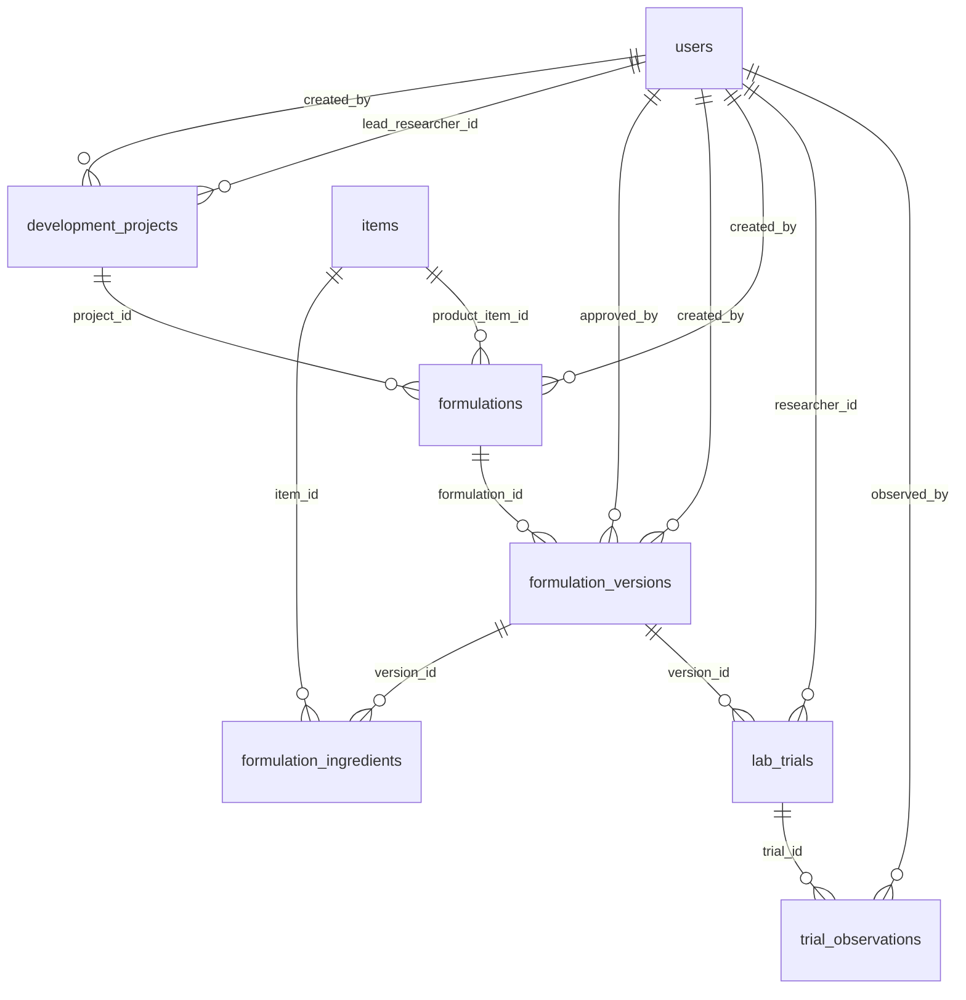

## Production

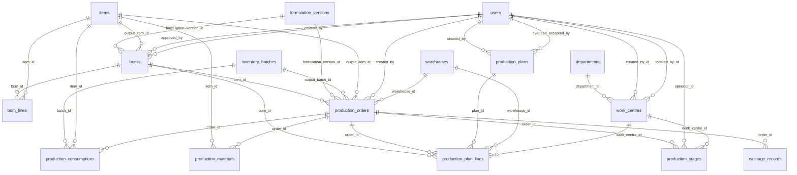

## Quality

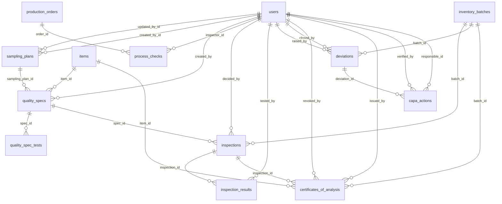

## Dispatch & logistics

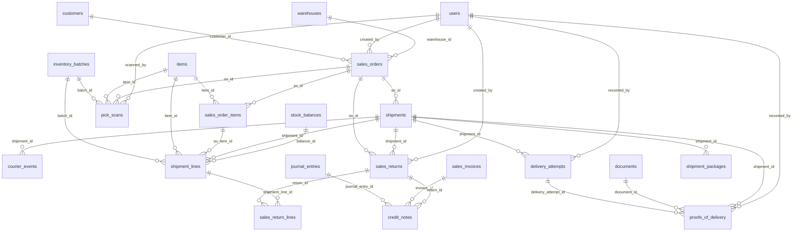

## CRM & sales

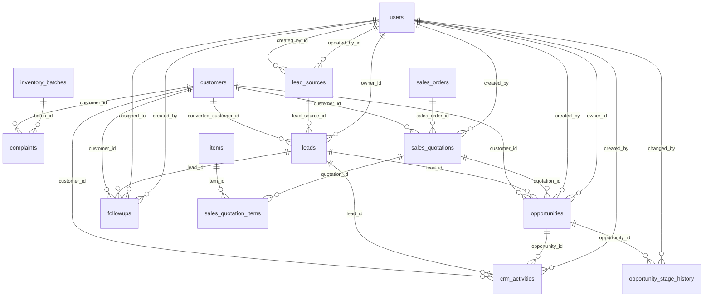

## Accounts & finance

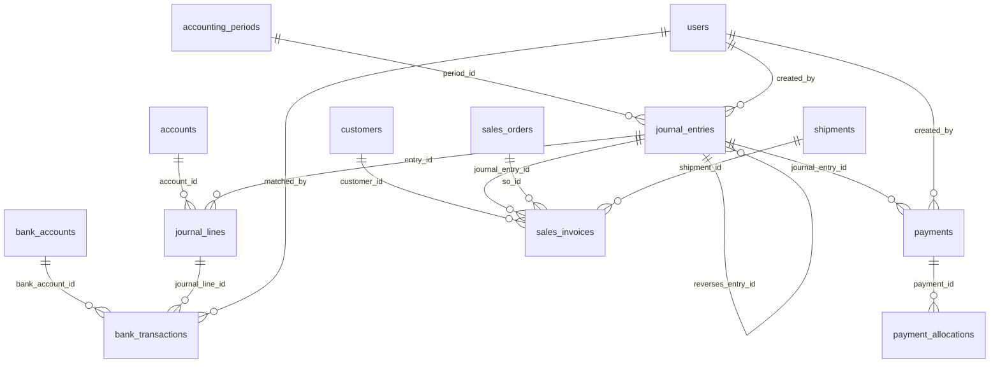

## E-commerce & marketplaces

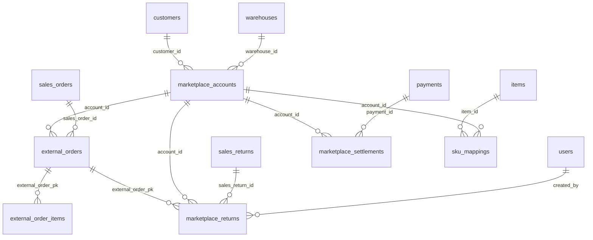

## Maintenance

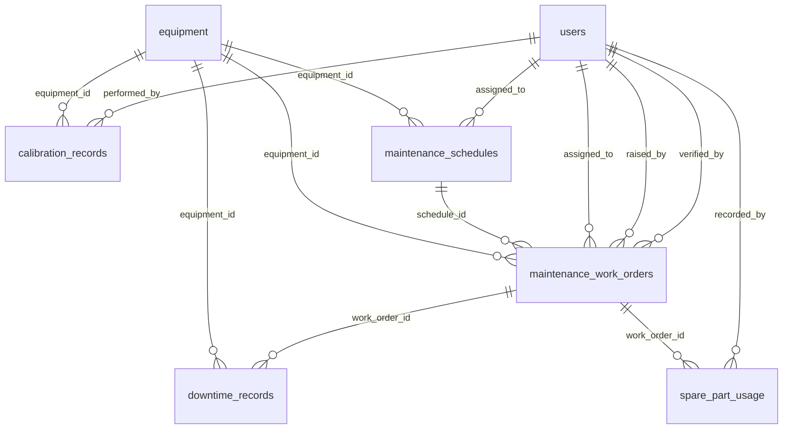

## Branding & marketing

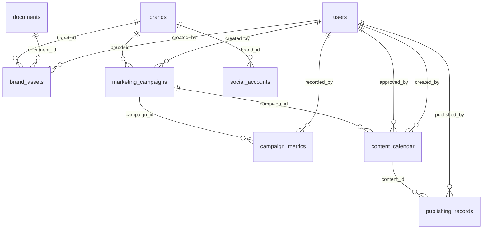

## Approvals, notifications & documents

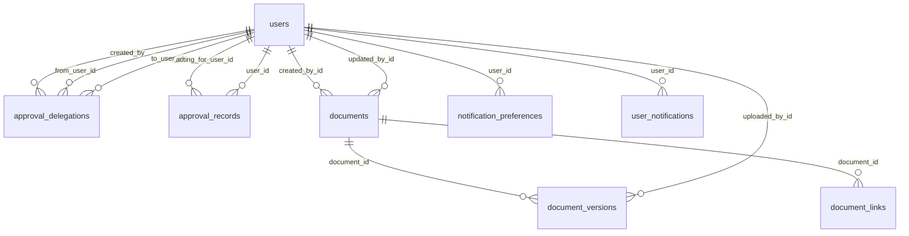

## Cross-domain references (who reuses whose records)

| Domain | References records owned by | Via tables |
|---|---|---|
| Accounts & finance | Dispatch & logistics | `sales_orders`, `shipments` |
| Accounts & finance | Identity, access & audit | `users` |
| Accounts & finance | Master data | `customers` |
| Approvals, notifications & documents | Identity, access & audit | `users` |
| Branding & marketing | Approvals, notifications & documents | `documents` |
| Branding & marketing | Identity, access & audit | `users` |
| Branding & marketing | Master data | `brands` |
| CRM & sales | Dispatch & logistics | `sales_orders` |
| CRM & sales | Identity, access & audit | `users` |
| CRM & sales | Inventory | `inventory_batches` |
| CRM & sales | Master data | `customers`, `items` |
| Dispatch & logistics | Accounts & finance | `journal_entries`, `sales_invoices` |
| Dispatch & logistics | Approvals, notifications & documents | `documents` |
| Dispatch & logistics | Identity, access & audit | `users` |
| Dispatch & logistics | Inventory | `inventory_batches`, `stock_balances` |
| Dispatch & logistics | Master data | `customers`, `items`, `warehouses` |
| E-commerce & marketplaces | Accounts & finance | `payments` |
| E-commerce & marketplaces | Dispatch & logistics | `sales_orders`, `sales_returns` |
| E-commerce & marketplaces | Identity, access & audit | `users` |
| E-commerce & marketplaces | Master data | `customers`, `items`, `warehouses` |
| Inventory | Identity, access & audit | `users` |
| Inventory | Master data | `items`, `storage_locations`, `suppliers`, `warehouses` |
| Maintenance | Identity, access & audit | `users` |
| Master data | Identity, access & audit | `users` |
| Platform & infrastructure | E-commerce & marketplaces | `marketplace_accounts` |
| Platform & infrastructure | Identity, access & audit | `users` |
| Procurement | Accounts & finance | `journal_entries` |
| Procurement | Identity, access & audit | `departments`, `users` |
| Procurement | Inventory | `inventory_batches` |
| Procurement | Master data | `items`, `storage_locations`, `suppliers`, `warehouses` |
| Production | Identity, access & audit | `departments`, `users` |
| Production | Inventory | `inventory_batches` |
| Production | Master data | `items`, `warehouses` |
| Production | R&D & formulation | `formulation_versions` |
| Quality | Identity, access & audit | `users` |
| Quality | Inventory | `inventory_batches` |
| Quality | Master data | `items` |
| Quality | Production | `production_orders` |
| R&D & formulation | Identity, access & audit | `users` |
| R&D & formulation | Master data | `items` |
