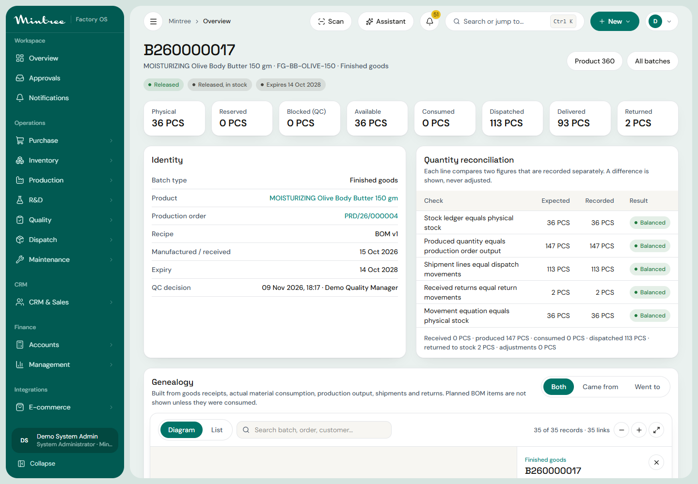
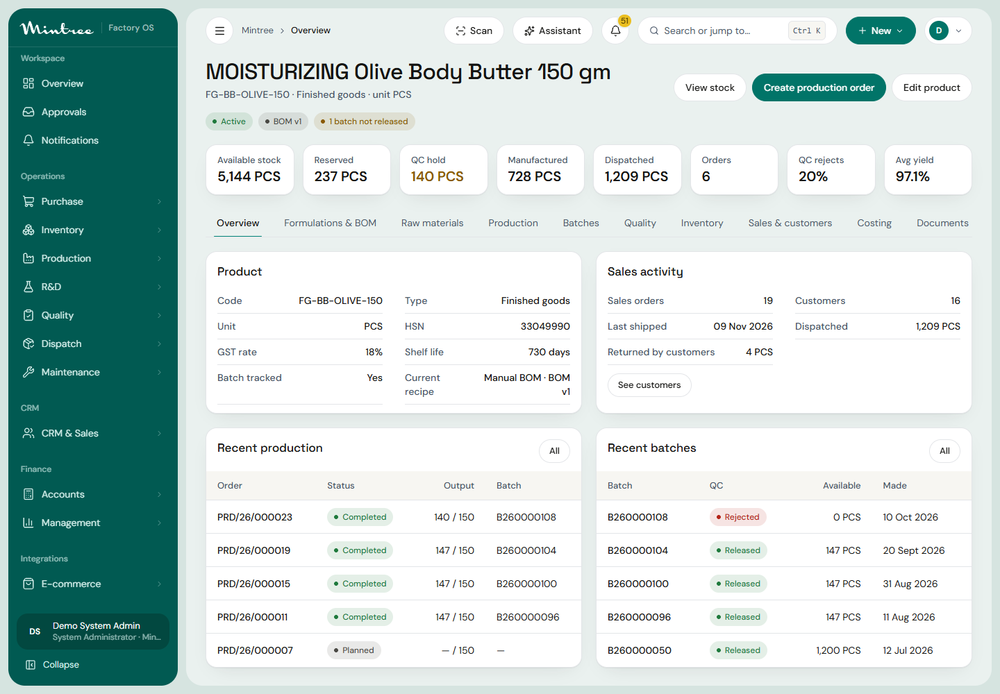

# Product 360 and Batch 360: architecture

Two connected, **read-only** views over the transactional tables that already exist. Nothing here posts stock, production, quality or sales records, and there is **no separate genealogy table**: every relationship shown is derived from rows the business already wrote. That is what keeps it honest, and it is why an old batch can be traced without a back-fill.




## Where to find it

| Screen | Route | Needs |
|---|---|---|
| Batch list (entry) | `/inventory/batches` | `inventory.batch:read` |
| Batch 360 | `/inventory/batches/{id}/traceability` | `inventory.batch:read` |
| Impact analysis (a tab of Batch 360) | same page | `inventory.batch:qc_release` as well |
| Product list (entry) | `/inventory/products` | `inventory.batch:read` |
| Product 360 | `/inventory/products/{id}/overview` | `inventory.batch:read` |

Both are in the sidebar under Inventory ("Batch traceability", "Product 360"). Every record shown links to its own screen (`?open=<id>`), and every batch node links to its own Batch 360.

## Layers

```
Browser   components/trace/{BatchPage, ProductPage, Genealogy, Lists, bits}.tsx      lazy tabs, paginated tables, SVG diagram
API       app/traceability/router.py       thin: permission gate, paging limits, masking flags
Service   app/traceability/service.py      all SQL; batched per generation; bounded; no writes (impact analysis writes ONE audit row)
Data      existing tables                  see "Source of truth" below
```

## Source of truth (no duplicate tables)

| Question | Table(s) and column that answers it |
|---|---|
| Which lots really went into a production order | `production_consumptions (order_id, batch_id, item_id, qty)`. **Not** the BOM. |
| What the order was meant to use | `production_materials (required_qty, issued_qty)`; shown as *planned*, never as genealogy |
| Which batch an order produced | `production_orders.output_batch_id` |
| Which recipe | `production_orders.formulation_version_id` → `formulation_versions` / `formulations`; `bom_id` → `boms` |
| Where a raw lot came from | `goods_receipt_items.batch_id` → `goods_receipts` → `purchase_orders` → `suppliers`; `inventory_batches.supplier_lot_no` |
| Opening-stock lots | `inventory_batches.source_type = 'opening_stock'` and the ledger `RECEIPT` rows with that source |
| Where a batch is now | `stock_balances (batch_id, warehouse_id, location_id)` |
| What happened to the quantity | `stock_ledger` (append-only): `RECEIPT, PRODUCTION_ISSUE, PRODUCTION_OUTPUT, DISPATCH, RETURN, TRANSFER_OUT/IN, ADJUSTMENT, REVERSAL, ISSUE (to supplier), QC_*` |
| Which customer got it | `shipment_lines.batch_id` → `shipments` → `sales_orders` → `customers` |
| Returns | `sales_return_lines.shipment_line_id` → `shipment_lines.batch_id`; `sales_returns` (status, decision) |
| Reservations | `stock_reservations` via `balance_id` → `stock_balances.batch_id` |
| Quality | `inspections`, `inspection_results` (append-only: a failed result is never overwritten) |
| Who changed what | `audit_logs` |

## Graph construction

A graph is nodes (real records) and edges (real quantities). It is built **one generation at a time**:

* **Backward** from a batch: receipts and POs that supplied it; the production order that made it and the formulation/BOM it used; the batches that order *actually consumed* (and, because a consumed batch may itself be a bulk batch, their own receipts or orders, up to the depth limit); QC inspections attached to every batch.
* **Forward** from a batch: production orders that consumed it, the batches they produced (repeated for bulk → finished), reservations, shipments → sales orders → customers, returns off those shipments, the warehouses holding it, QC inspections.

Each generation costs one query per relationship type for **all** batches in that generation (`WHERE batch_id = ANY(:ids)`), so cost is bound by depth, not by node count. Measured on the demo database (warm): graph of 42 nodes = 24 statements / 57 ms; product summary = 8 statements / 27 ms. Limits: depth 6, 300 nodes; when a limit is hit the response says `truncated: true` and the UI says so.

## Not in scope, and why

* **Child batches and merging.** The system has no child-batch or merge concept (no table, no workflow). A "split" is one batch held in several `stock_balances` after a transfer; it keeps one identity and its ledger shows the `TRANSFER_OUT/IN` legs. Merging stock is not a supported operation, so none is invented. See `BATCH_GENEALOGY.md`.
* **Precomputed genealogy / recursive CTE.** Not needed at current volumes (see timings); the per-generation approach is simpler, index-friendly and keeps one source of truth. Revisit if a graph routinely hits the 300-node cap.
* **Production material returns to stock.** The production module has no return-to-stock movement, so "returned" for materials is always 0 and the page shows only what exists.

## Security

Batch read endpoints need `inventory.batch:read`; impact analysis needs `inventory.batch:qc_release` too. Names of suppliers and customers are returned only to users who hold `masters.supplier:read` / `masters.customer:read`; otherwise they are the literal text "Restricted" and carry no link. The UI never gates anything; every check is on the server (tested: `test_permissions_masking_audit_and_read_only`).
