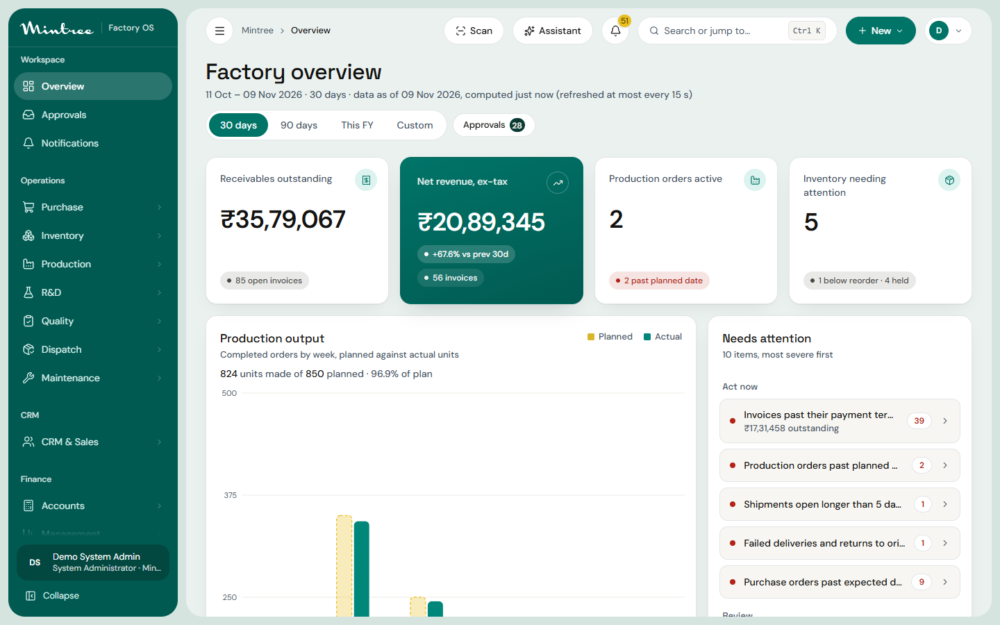
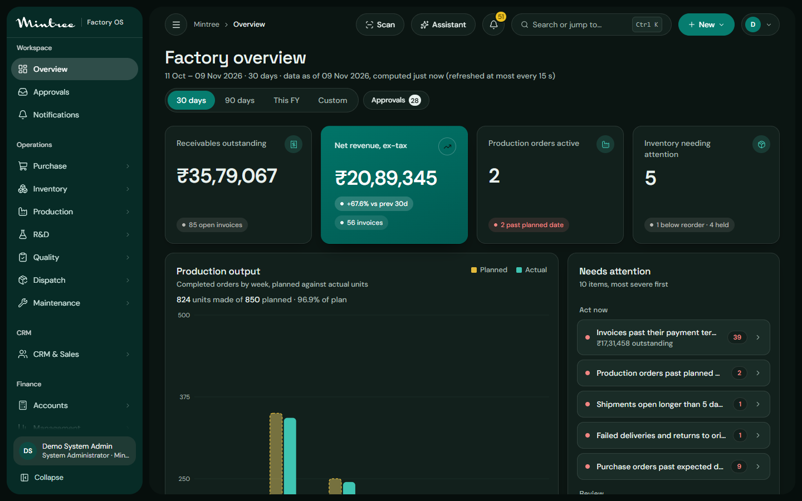

# UI design review and redesign (Apple HIG lens)

Reviewed and reworked: the Mintree Factory OS frontend (Next.js web app, desktop first, used on phones too). Method: read the relevant HIG pages, **measure** the running UI (contrast from the actual token values, control sizes from the rendered DOM, text scaling, dark appearance, phone width), fix, and measure again. The brand, every route, every piece of data and every behaviour are unchanged.

Scope note: this is a web app, so Apple's *platform* conventions (tab bars, sheets, the menu bar) do not apply literally; the principles and foundations do (accessibility, color, typography, layout, writing, motion, dark appearance).

## Summary

**Before: Needs work.** A clear point of view (teal identity, restrained yellow, a floating shell) but the foundations under it did not meet the HIG: seven text pairings below 4.5:1, text that ignored the browser's text-size setting, controls under the recommended touch size, and a dark appearance left over from an earlier palette (an unreadable hero card, brown chart bars, a lost sidebar). **After: Good**, with the exceptions in the last section. The design's thesis is unchanged: *a calm, exact factory instrument whose one signature is the deep-teal hero card and the traceability diagram.*

## Critical (accessibility failures)

| # | Finding | Evidence (before → after) | Why |
|---|---|---|---|
| 1 | Brand teal used as **text** (links, "Open record") failed contrast | `#01877a` on white **4.42:1**, on the canvas **3.86:1** → `--brand #017468`: **5.68 / 4.95:1**. The logo teal survives as `--brand-bright`, for fills and chart series only | `accessibility.md › Color and effects`: "Up to 17 pts … 4.5:1" |
| 2 | Placeholders, axis ticks, "faint" text failed | `#8a887f` on white **3.55:1** → `#5d6871` **5.70:1** (canvas 4.97). "Subtle" eyebrows 4.03 → 5.88 | same |
| 3 | Sidebar group labels and the hero card's labels failed | white at 65% on the sidebar **4.40:1** → 82%: **6.0:1**; hero label 78% **4.09:1** → 92%: **5.07–7.16:1** | same |
| 4 | **Text ignored the text-size setting.** Sizes were fixed px, so a doubled root size left the body at 14 px | body at 200% root: **14 px → 28 px**. Type styles, control heights and paddings are now rem. Checked in a 720 px window at 200% text: no horizontal overflow, no clipped figures | `accessibility.md`: "enlarge text by at least 200 percent"; `layout.md › Be prepared for text-size changes` |
| 5 | Dark appearance was broken | the hero card's "Net revenue" label was dark-on-teal (invisible), one chip unreadable, chart "planned" bars brown, the teal sidebar replaced by black, "faint" text **3.52:1**. Rebuilt as a teal-ink theme: every text pairing ≥ 4.5:1, every control edge ≥ 3:1 (values in `globals.css`) | `dark-mode.md › Ensure that your app looks good in both appearance modes` |
| 6 | Touch controls well under 44 pt | phone: **65–90 controls per page under 44 pt** → **0** on Overview and Batches; desktop sidebar group headers (24 px) and the logo link (20 px) under the 28 pt desktop default → **0 under 28 pt** on every page measured | `accessibility.md › Offer sufficiently sized controls`: iOS default 44×44, macOS 28×28 |

## Improvements

| Tag | Finding | Fix |
|---|---|---|
| High | A text field's edge was **1.23:1** against its fill: a box you could barely see | `--field-border` 3.7:1 on white (3.4:1 on an inset), 3.5:1 in dark; placeholder uses the accessible faint colour |
| High | No Increase Contrast answer (`accessibility.md`: "provide a higher contrast color scheme when Increase Contrast is turned on") | `@media (prefers-contrast: more)` steps muted, faint, borders and the sidebar label up a level in both appearances |
| High | Keyboard focus ring was teal **on the teal sidebar**: invisible | white 2 px ring inside the sidebar; skip link added ("Skip to content"), `main` is a labelled landmark |
| High | The phone header pushed the avatar off screen | "New" is an icon on narrow screens (still labelled for screen readers) |
| Medium | **Motion on frequent interactions.** My earlier hover lifts, icon scaling, a sheen sweep on every primary button, a 10 px page rise and staggered card entrances | removed; kept a small press on click, shadow fades, menu pops and a 160 ms cross-fade per navigation. `motion.md`: "generally avoid adding motion to UI interactions that occur frequently"; "make motion optional" (reduced-motion unchanged) |
| Medium | The theme choice was saved on first load, so a later system change was ignored, and dark users saw a flash of light | follows the system until the person picks one; only an explicit pick is stored; "Match system appearance" undoes it; applied before first paint. `dark-mode.md`: "Avoid offering an app-specific appearance setting" (it is an override, not the default) |
| Medium | Hard-coded hex in components (diagram nodes, board tooltip, hero chip) | semantic tokens (`--g-*` record families, `--on-hero`, `--fg-on-ink`), each defined for light and dark |
| Low | Phones with a notch or home indicator | `viewport-fit=cover`, safe-area padding for content and the drawer; page can still be zoomed (no `maximum-scale`); per-appearance `theme-color` |

## Craft notes

* **Point of view: kept.** The deep-teal hero card, the traceability diagram and the one soft-yellow accent are the memorable things; nothing was added to compete with them.
* **Typography:** two families (DM Sans for text and figures, Space Grotesk for page titles only), weights 400-600, sentence case, tabular digits in tables, proportional elsewhere. Unchanged in character, now scalable.
* **Branding vs content (`branding.md`).** Apple advises using the accent colour judiciously, on primary actions and status rather than large areas. The **teal sidebar** is a large brand-colour mass; it was your explicit request and gives the product its identity, so it stays. The trade-off is named: it pulls attention away from content, and the content layer (cards, tables) is kept neutral to compensate.
* **Liquid Glass / blur:** not used. The shell has nothing scrolling beneath a floating bar, so glass would be decoration (`materials.md › Don't use Liquid Glass in the content layer`).

## What works (kept as is)

Sentence-case labels; one icon set at one stroke; status never by colour alone (every badge has a dot **and** text); focus rings on every control; empty, loading and error states that say what to do; the reconciliation panel that reports a mismatch instead of hiding it; segmented controls and menus built from real buttons; the sidebar capped at two levels and collapsible (`sidebars.md`).

## Platform notes

* **Measured, not assumed.** Contrast numbers come from the token values (a script that applies the WCAG formula); control sizes from `getBoundingClientRect` in a real browser at 1440 px and at 390 px with touch emulation; both appearances screenshotted.
* **Regression:** type-check clean, production build clean, the 12-step traceability browser journey passes on the redesigned UI.

## Not done, honestly

* **Diagram collapse chevrons on a phone** are 38 pt, not 44: the diagram is scaled by its zoom, which scales its controls. Zoom in to make them larger; they are a secondary control.
* **VoiceOver / TalkBack pass** was not run. Roles and labels exist (tabs, dialogs, labelled buttons, a text alternative for the diagram), but no screen-reader audit was performed.
* **200% text** was verified in a narrow window, not with a real browser text-size setting; wide layouts at 200% text have **not** been redesigned (the breakpoints reflow, but KPI cards with a long figure were not individually tuned).
* **Only some screens were measured** (Overview, Batch list, CRM board, Batch 360, phone Overview/Batches/Batch 360). Other modules inherit the same tokens and components but were not individually audited.
* Control edges at 3:1 make fields more visible and slightly heavier; that is deliberate, and `--field-border` is the one token to soften if the look is too strong.
